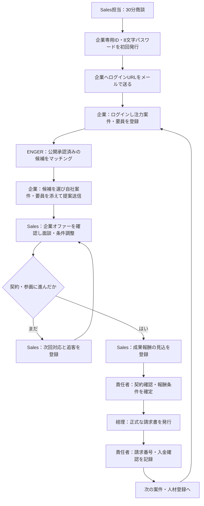

# ENGER｜成果報酬につながる営業サイクル（メンバー向け）

**目的**：商談して終わりではなく、企業が案件・人材を追加するたびに提案・有償参画を生み、エイトの成果報酬を記録する。

## 全体の流れ

## 操作手順

| 誰 | どの画面 | 操作 | 完了条件 |
|---|---|---|---|
| Sales担当 | [企業一覧](https://gw.8grp.co.jp/sales/company-segments.html) | 企業情報→AI分析→候補確認→商談 | 法人と担当者の情報が確認できている |
| Sales担当 | [30分商談](https://gw.8grp.co.jp/sales/company-meeting.html) | クロージング時「企業専用ページを発行して案内メールを送信」 | 送信履歴が残る。既存パスワードは変更しない |
| 企業担当者 | [企業ログイン](https://enger.jp/business/login) | メール記載のIDと初回パスワードでログイン | 企業専用ページを表示 |
| 企業担当者 | [企業商談](https://enger.jp/business/meeting) | 「注力案件・要員を登録」→候補チェック→該当自社情報を指定→提案 | エイトのオファー一覧に記録される |
| Sales担当 | 企業詳細→企業からのオファー | 内容確認→電話・面談→条件調整→対応状態更新 | 契約成立の根拠が確認できる |
| Sales担当 | 企業詳細→**成果報酬・入金管理** | オファー、手数料モデル、一時金または月次手数料、支払企業を入力し「見込として登録」 | 見込は未確定のまま保存 |
| 営業責任者 | 同じ画面 | オファーを「成約確認待ち」にし、契約書などの参照先を入力して「契約確認」 | 実在する契約根拠を確認 |
| 経理担当・責任者 | 経理の正規フロー／同じ画面 | 正式な請求書を発行してから「請求記録」、入金後「入金確認」 | 請求番号・入金記録が紐づく |

### 成果報酬の決め方
- **一時金**：契約が成立したときに1件につき1回の手数料を登録
- **継続手数料**：毎月の稼働実績・契約条件を確認し、**対象月ごとに**記録
- 手数料額と「誰が支払うか」は**契約の合意内容に従う**。ENGER側で勝手に金額を決めない
- 見込金額・契約確認済み・請求記録済み・入金確認済みは**別の数字**。金額を足して「売上」としない

### お客様への説明（30秒）
「ENGERの企業専用ページは、初期費用・月額利用料なしの成果報酬型モデルを想定しています。案件や所属人材を簡単に登録していただくと、条件に合う候補をご提案します。実際の取引が成立した場合のみ、個別に合意した契約条件に従って手数料が発生します。料金条件は契約前に必ず確認いただきます。」

**重要**：正式な無料提供・手数料条件は、確定した利用規約・個別契約を提示してから案内してください。この文面は営業説明案であり、確定した料金規約ではありません。

### 安全上のルール
- 元メール・スキルシートには所属企業、仕入単価、個人情報が含まれるため、**原本をそのまま企業へ共有しない**
- 企業が登録した案件・人材は**エイトの承認前には他社へ公開しない**
- 契約成立前に「売上」としない。請求書も成果報酬台帳からは発行しない
- 企業IDは企業単位で認証し、他社の情報を取り違えない
- 8文字パスワードの初回発行は一度のみ。既存企業にはログインリンクを案内し、勝手に再発行しない
- メールに初回パスワードを含める運用はリスクを伴う。初回ログイン後の変更・安全な受け渡しを徹底

## 管理する基本KPI

商談件数 → 案内メール送信数 → ログイン数 → 注力情報登録数 → オファー送信数 → 面談数 → 参画数 → 契約確認済み手数料 → 請求済み → 入金済み

**毎週チェック**：どの段階で止まったか、次に誰が動くかを確認する。登録数だけではなく、有償参画と入金につながったかを振り返る。

## 既存機能と今回追加したもの
- **既存**：商談フロー、企業ログインメール、登録・匿名候補提案、Salesオファー管理
- **追加**：オファー連動の成果報酬台帳（1回/対象月）、契約確認の承認、請求・入金の記録
- **今後の別開発**：経理システムとの正式な請求書連携、月次稼働確定からの自動計上、法務レビュー済みの利用規約、全体ファネルの自動集計
